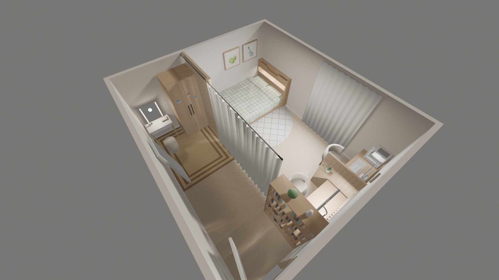
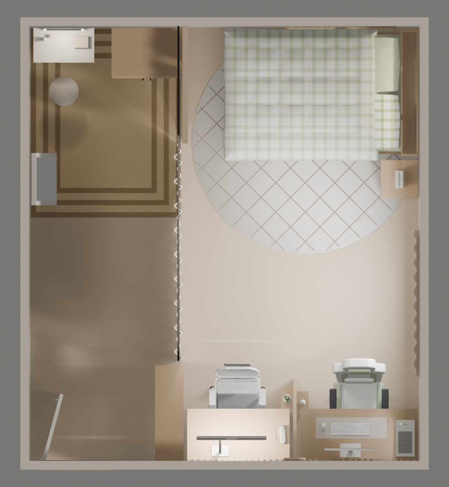
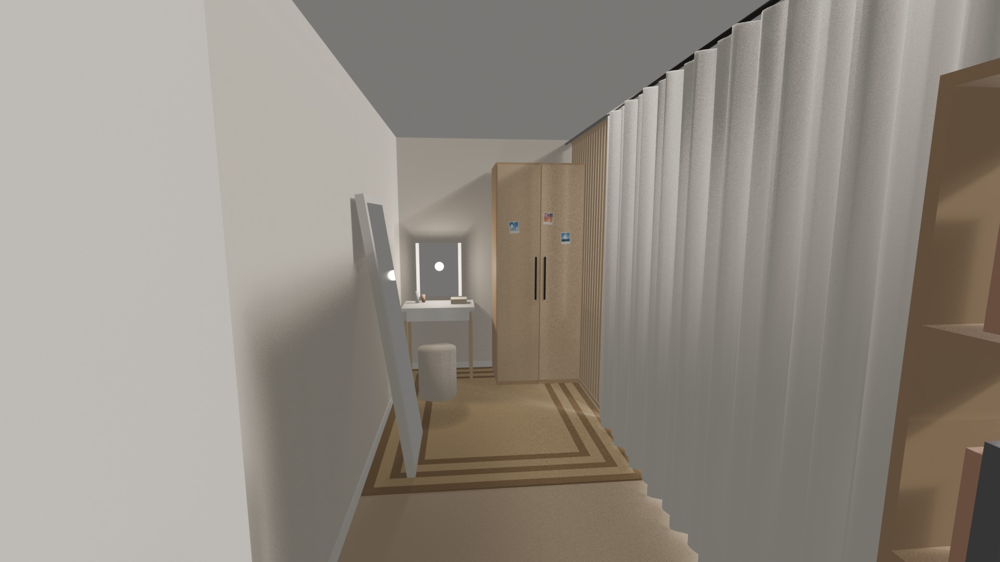
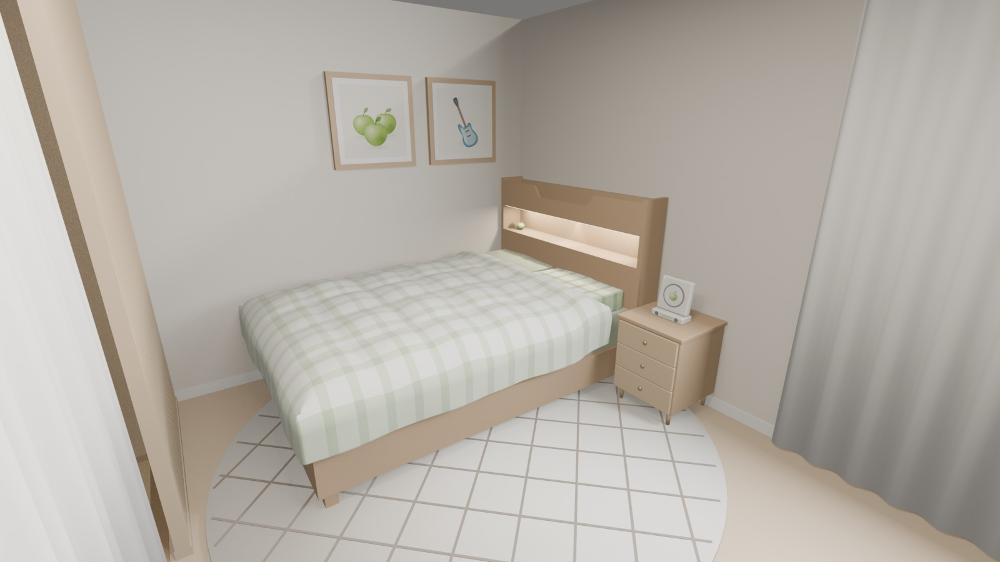
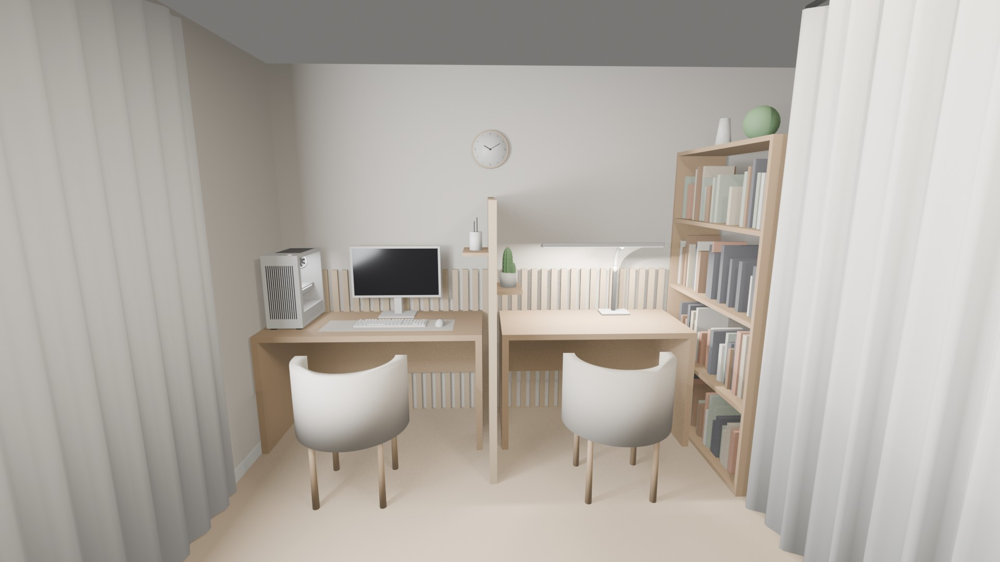

# 🏠 손그림을 3D로: Claude × Blender MCP로 만든 나만의 방

직접 손으로 그린 방 그림을 **Claude(AI)** 에게 보여 주고, **Blender MCP**로 연결해서 대화만으로 3D 방을 만든 프로젝트예요.



## 📌 프로젝트 정보

| 항목 | 내용 |
|---|---|
| 도구 | Blender 5.2 + Blender MCP 애드온 + Claude |
| 방 크기 | 가로 4.5m × 세로 5m × 높이 2.4m |
| 스타일 | 우드톤 + 크림 + 세이지 그린 + 화이트 |
| 만든 방법 | 손그림(평면도, 벽면) → Claude에게 설명 → MCP로 Blender에서 자동 생성 → 대화하며 수정 |

## 🖼️ 완성 사진

| 위에서 본 평면도 | 입구에서 본 모습 |
|---|---|
|  |  |

| 침대 쪽 | 책상 쪽 |
|---|---|
|  |  |

## 🛋️ 방 구성

- **입구 쪽:** 벽에 기댄 전신거울, 조명 화장대, 문 2개 옷장(하늘 사진 폴라로이드 + 연두색 압정), 라탄 러그
- **공간 나누기:** 천장까지 닿는 원목 살 파티션 + 리넨 커튼
- **침대 쪽:** 더블 침대, 원목 수납 헤드보드(LED 조명), 세이지 그린 체크 이불과 베개, 동그란 러그, 수채화 액자 2개(청사과, 파란 일렉기타), 창문과 시폰 커튼
- **책상 쪽:** 책상 2개 사이 타공판(선인장 화분, 연필꽂이), 원목 테두리 벽시계, 와이드 LED 스탠드, 화이트 PC 세트(유리 옆판 본체, 풀배열 키보드, 무선 마우스, 모니터), 원목 책장
- **의자:** 화이트 게이밍 의자(세이지 그린 줄무늬, 뒷면에 청사과 그림)와 인체공학 메쉬 의자(흰 테두리 등판, Y자 지지대, 헤드레스트)

## 🔧 만든 과정

1. **손그림 그리기:** 위에서 본 평면도와 입구에서 본 벽면을 그렸어요.
2. **MCP 연결:** Blender에 MCP 애드온을 설치하고 서버를 켜서 Claude와 연결했어요.
   - 처음엔 백그라운드 실행 도구가 Blender 경로를 못 찾는 문제가 있었어요. 그래서 Blender 창에 연결하는 방식으로 바꿔서 해결했어요.
3. **첫 번째 버전:** 그림을 바탕으로 가구를 배치했어요.
4. **레퍼런스 반영:** 원하는 분위기의 사진을 보여 주고 스타일과 배치를 다시 잡았어요.
5. **디테일 수정:** 대화로 하나씩 고쳤어요. 침구, 헤드보드, 액자 그림, 폴라로이드, 시계, 식물, 스탠드, 키보드, 마우스, 본체, 의자 순서로 다듬었어요.

중간 과정 사진은 [`process/`](process) 폴더에 순서대로 들어 있어요.

## 📁 파일 구성

| 파일/폴더 | 설명 |
|---|---|
| `my_room.blend` | 완성된 Blender 파일 (그림, 사진 텍스처 포함) |
| `build_room.py` | 방 전체를 만드는 Python 코드 (Blender에서 실행) |
| `renders/` | 완성 렌더링 사진 |
| `process/` | 수정하면서 찍은 중간 과정 사진 |
| `textures/` | 직접 만든 수채화 그림, 폴라로이드 사진, 의자 뒷면 청사과 그림 |

## ▶️ 직접 실행해 보기

Blender 5.1 이상에서 아래처럼 실행하면 방이 처음부터 다시 만들어져요.

```bash
blender --background --factory-startup --python build_room.py
```

> `textures/` 폴더가 `문서/Claude_Room/textures` 위치에 있어야 그림과 사진이 들어가요.
